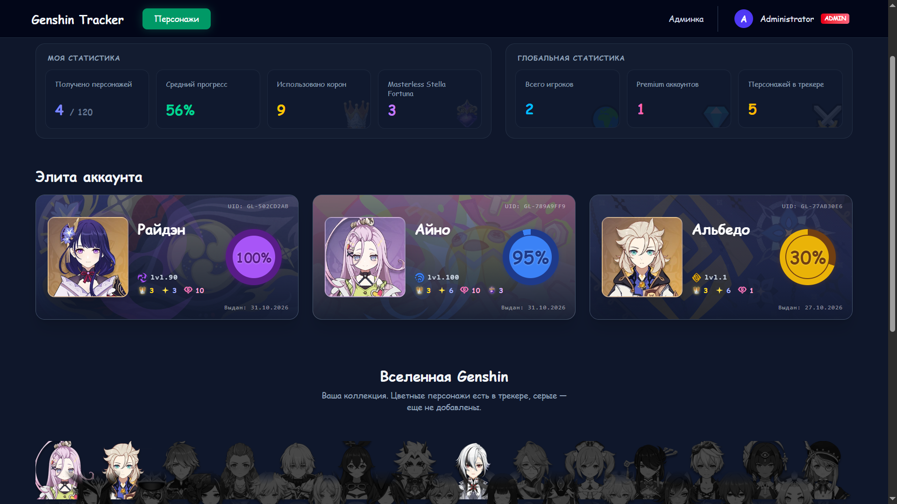
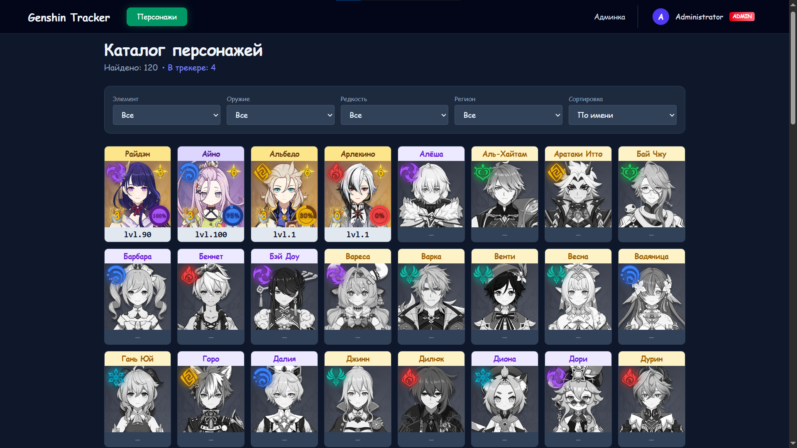
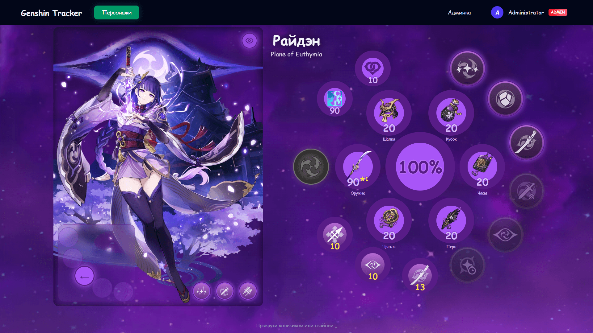
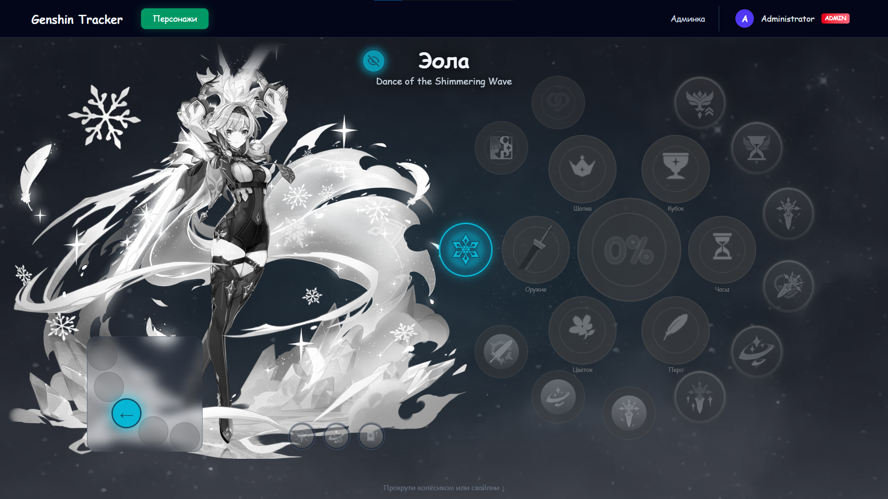
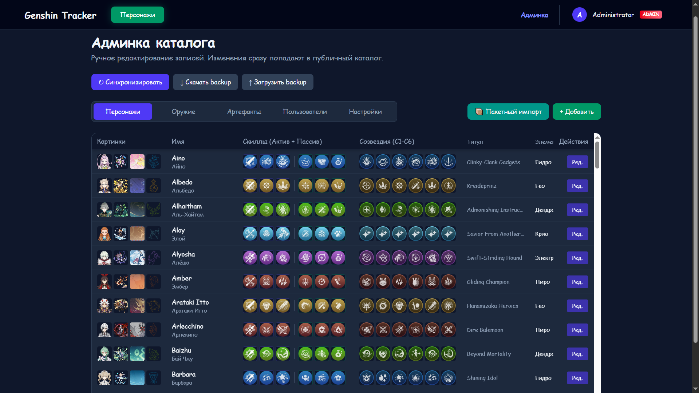

# Genshin Progress Tracker

<div align="center">


**Full-stack web application for tracking character progression in Genshin Impact.**

*Fills a gap: existing trackers are either EN-only, paid, or lack the "investment percentage" view.*

</div>

---

## ✨ Features

- 🔐 **Authentication & Security:** JWT in httpOnly cookies, refresh token rotation, RBAC (Admin, Premium, User).
- 📊 **Smart Progress Formula:** Calculates a weighted 0–100% investment score based on level, talents, weapon, artifacts, and friendship.
- 🎨 **Interactive UI:** Custom scroll-based navigation, radial SVG progress rings, smooth animations, and elemental dynamic backgrounds.
- 💳 **Payments (Strategy Pattern):** Stripe (fully active) and YooKassa (backend implemented, awaiting store verification).
- ⚙️ **Admin Dashboard:** Sync catalog from external API, manage users, adjust progress weights, and view financial stats.
- ✅ **Quality Assurance:** strict `mypy`, `ruff`, `pre-commit` hooks, and 73% backend test coverage.

## 📸 Screenshots

| Dashboard & Stats | Character Catalog |
|:---:|:---:|
|  |  |

| Character Progress (Owned) | Character Progress (Unowned) |
|:---:|:---:|
|  |  |

| Admin Panel |
|:---:|
|  |

## 🛠 Tech Stack

- **Backend:** Python 3.12, FastAPI, Pydantic v2, SQLAlchemy 2.0 (async), Alembic, asyncpg.
- **Frontend:** React 18, TypeScript, Vite, TanStack Query, Zustand, Tailwind CSS.
- **Infrastructure:** PostgreSQL 16, Redis 7, Docker Compose, GitHub Actions.
- **Integrations:** Stripe, YooKassa, Genshin-DB API.

## 🚀 Quick Start

Requirements: Docker Desktop, Git.

```bash
git clone https://github.com/ttWhithe/Genshin-Tracker.git
cd Genshin-Tracker
copy .env.example .env
python -c "import secrets; print(secrets.token_urlsafe(64))"
docker compose up --build
```

Then open:
- **Frontend:** http://localhost:5173
- **API Docs (Swagger UI):** http://localhost:8000/docs

## 🧪 Development & Testing

Run linters and tests locally (inside Docker):

```bash
docker compose exec backend pytest
docker compose exec backend mypy app
docker compose exec backend ruff check app
```

## 📄 Documentation

- [Software Requirements Specification](docs/spec.md) — full SRS, MVP scope, architecture details.

## ⚠️ Disclaimer

Not affiliated with HoYoverse. Uses public game data for educational and portfolio purposes.
